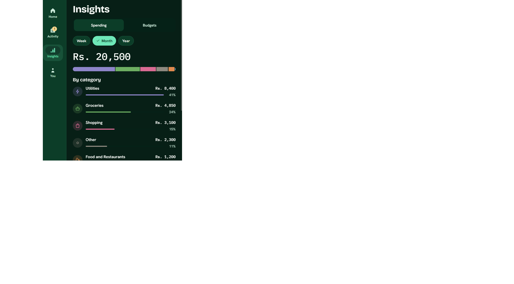
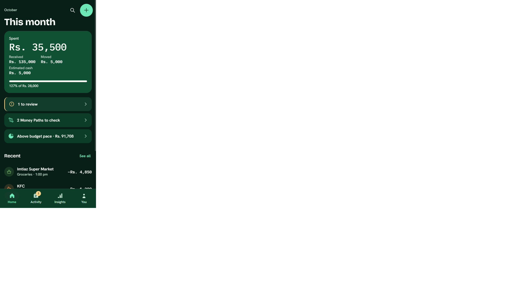
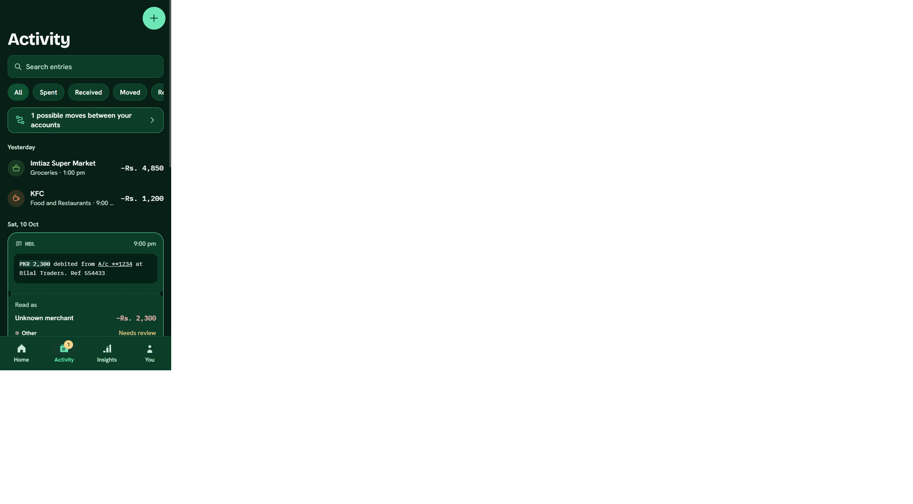
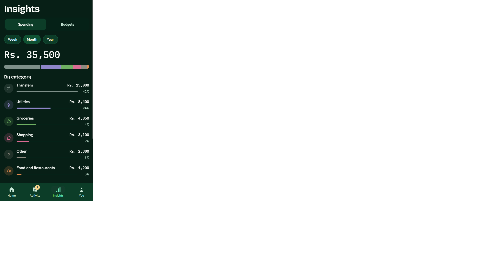
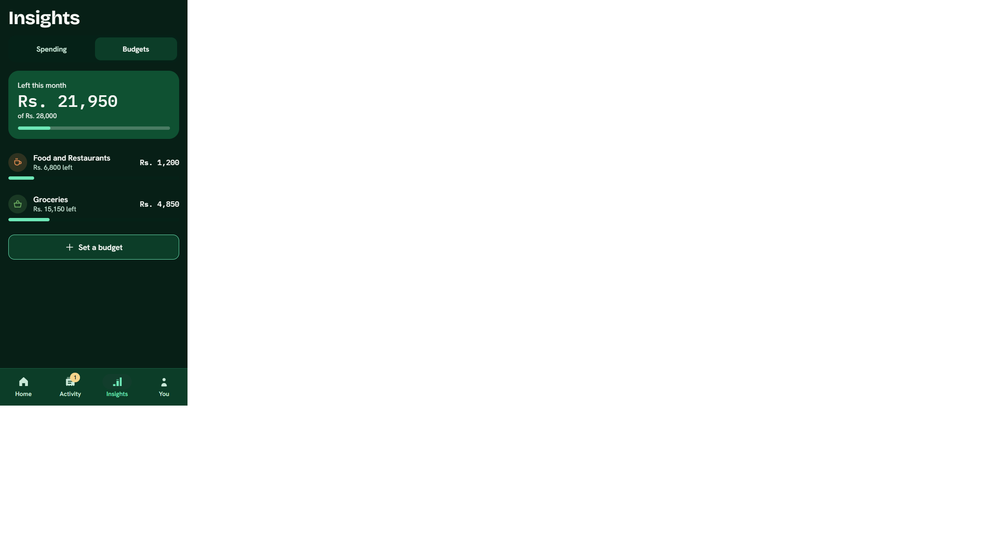
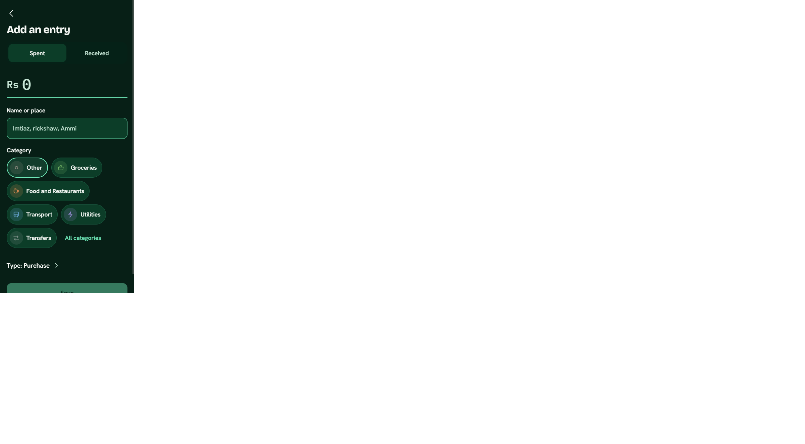
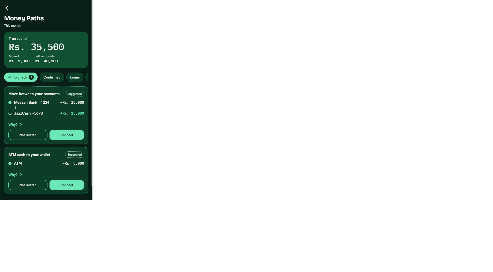
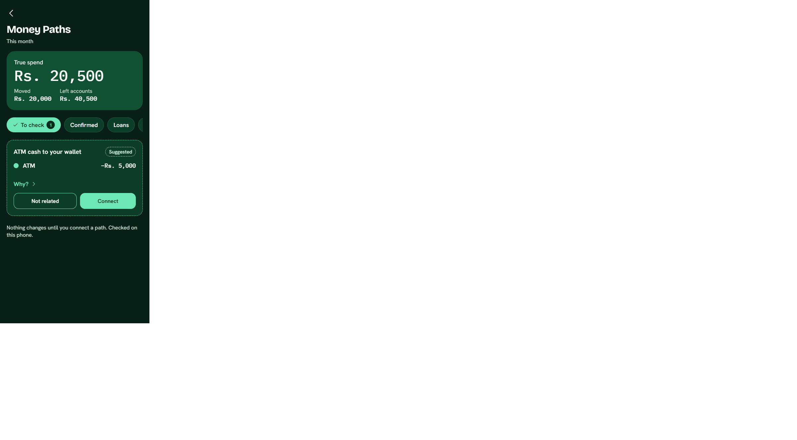
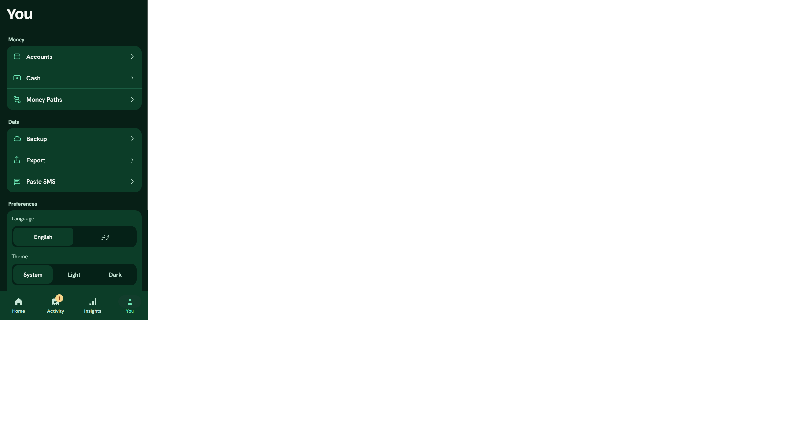
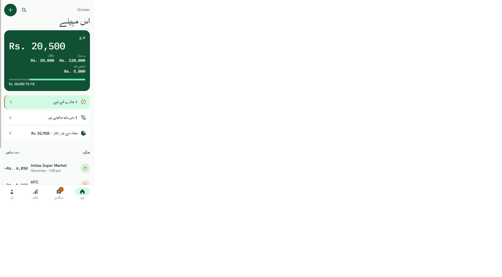

# Before and after: UI audit

"Before" is `main` at `cce43ba` (1.1.0-rc.1), read from source. "After" is the 1.1.0-rc.2 working tree. The audit IDs refer to [CURRENT_PRODUCT_AUDIT.md](../research/CURRENT_PRODUCT_AUDIT.md).

The "after" screenshots come from the Expo web build at 360dp (320dp for Add, 840dp for the rail), using an invented demo ledger. They are not phone screenshots. A few were taken before the final selected-chip style (accent fill plus check) landed.

## Navigation and layout

| Audit | Before | After | Check |
|-------|--------|-------|-------|
| N1 | Tab bar fixed at `height: 72`, so it ignored the system inset | Height is 64 + max(inset, 8), from `tabBarHeight()` | `redesign.test.mjs`: inset 0 gives 72, inset 48 gives 112 |
| N2 | You icon was the K path `M5 3h4v9l5-6h5l-6 7 6 8h-5l-5-7v7H5V3Z` | Person glyph | Test asserts the K path is absent from `Icon.tsx` |
| N3 | Five tabs, Budgets separate | Four tabs; Budgets is a view inside Insights | Test asserts four tabs and no `budgets.tsx` |
| N4 | 10sp custom label inside the icon slot | System tab label at 12sp; icon in a 56×30 pill when focused | Web check at 360dp: labels not clipped |
| N5 | Fixed bottom padding on stack screens | 24 + inset on stack screens, 16 on tab screens | `screenBottomPadding` test |
| N6 | No width breakpoints | At 600dp and wider, tabs become a left rail and content is centred at 720dp max | Web check at 840dp |

## Density and visuals

| Audit | Before | After |
|-------|--------|-------|
| D1 | Home: tagline, month slip, "Latest" list, three stacked buttons | One summary card, up to three attention rows, four recent rows, and "See all" |
| D2 | Several screens opened with an explanatory sentence | No screen opens with a paragraph; explanations sit behind "How this works" or "Why?" |
| D3 | Cash and digital split written as a sentence | Two bars with amounts |
| D4 | About listed every provider | Short facts; the bank list is collapsed |
| D5 | Category shown by a colour dot only | Glyph in a tinted circle for each category |

## Forms and wording

| Audit | Before | After |
|-------|--------|-------|
| F1 | Add showed enum names such as `cash withdrawal` and `adjustment` | Spent or Received first, then plain type names behind a "Type" disclosure: Purchase, ATM cash, Move between my accounts, Fee, Correction |
| F2 | Accounts showed `bank`, `wallet`, `cash` | Bank, Wallet, Cash |
| F3 | 21 category chips at once | Six (recent first) plus "All categories" |
| F5 | Ask was a blank field | Suggested questions answer in one tap |
| F6 | Some chips 36–44dp | Every chip and icon button has a 48dp target |

## Money Paths

| Audit | Before | After |
|-------|--------|-------|
| T3 | Suggested and confirmed threads looked the same apart from text | Suggested: dashed border, "Suggested" label, "Not related" and "Connect". Confirmed: solid accent border, check, Undo |
| Totals | Threads totals were computed separately from Home | Both use `periodSummary()`; connecting a Rs 15,000 move in the demo changed true spend from 35,500 to 20,500 on both screens |

## Accessibility and language

| Audit | Before | After |
|-------|--------|-------|
| A1 | Dark unless the system reported light | System, Light, or Dark under You |
| A3 | Progress always animated | `useReducedMotion()`; durations 150–250ms |
| A4 | Urdu labels only; layout not mirrored | `direction: 'rtl'`, mirrored chevrons, amounts kept left to right, bidi isolates on inserted values |

## Still open

- Activity's transfer suggestions and Money Paths use two separate systems (transfer links and threads). They show the same money from two angles and should be merged.
- Month names and Ask answers are English in Urdu mode. Bank SMS, Accounts, Backup, Export, and About are English only.
- The Urdu text has had no native-speaker review.
- The ATM cash suggestion in Money Paths repeats what the ATM cash type already says.
- The wide layout centres a single column. A two-pane layout is future work.
- None of this has been checked on a phone, with TalkBack, or at large font scales.
